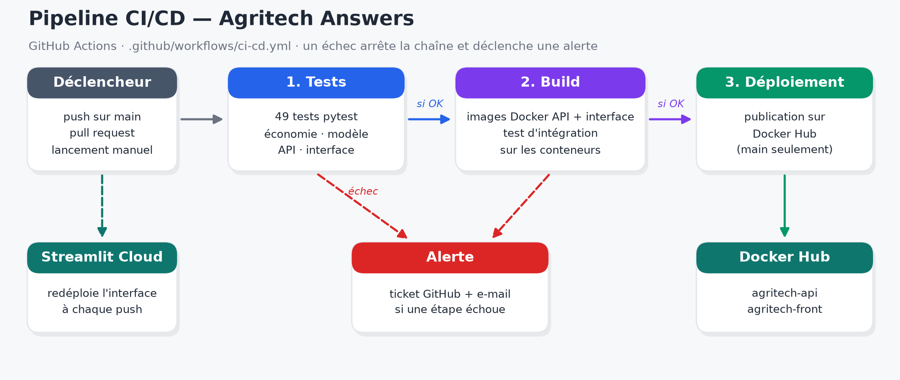
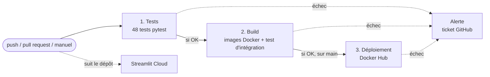

# Pipeline CI/CD

[](https://github.com/JoseBravo26/P11_agritech/actions/workflows/ci-cd.yml)
[](https://hub.docker.com/r/josibra/agritech-api)


> Dépôt GitHub : https://github.com/JoseBravo26/P11_agritech. Images Docker Hub : https://hub.docker.com/u/josibra. Le premier badge devient vert quand le dernier pipeline sur `main` a réussi, rouge sinon.

Le pipeline automatise la chaîne de production de l'application (API FastAPI et interface Streamlit) avec **GitHub Actions**. Il est défini dans un seul fichier : [`.github/workflows/ci-cd.yml`](../.github/workflows/ci-cd.yml).



## 1. Vue d'ensemble



| Étape (job) | Rôle | Quand | Ce qui la fait échouer |
|---|---|---|---|
| **1. Tests** (`tests`) | Lance les 48 tests automatisés | À chaque push sur `main`, pull request ou lancement manuel | Un seul test en échec |
| **2. Build** (`build`) | Construit les images Docker de l'API et de l'interface, les lance ensemble et les interroge réellement | Si les tests ont réussi | Image qui ne se construit pas, conteneur qui ne démarre pas, réponse incorrecte |
| **3. Déploiement** (`deploy`) | Publie les deux images sur Docker Hub, puis redéploie l'API chez l'hébergeur (optionnel) | Si le build a réussi, **sur `main` seulement**, et si Docker Hub est configuré | Identifiants refusés, publication impossible |
| **Alerte** (`alerte`) | Ouvre un ticket GitHub « Échec du pipeline CI/CD » (ou le complète s'il est déjà ouvert) | Si l'une des étapes précédentes échoue, hors pull request | — |

Chaque étape attend la réussite de la précédente (`needs:`) : **une image n'est jamais publiée si un test échoue**.

## 2. Déclencheurs

| Déclencheur | Étapes lancées | Pourquoi |
|---|---|---|
| `push` sur `main` | Tests, Build, Déploiement | Chaque modification du code produit une nouvelle image testée et publiée |
| `pull_request` vers `main` | Tests, Build | Vérifier une modification **avant** de l'accepter, sans rien publier |
| `workflow_dispatch` (bouton « Run workflow » de l'onglet Actions) | Tests, Build, Déploiement (si lancé sur `main`) | Relancer à la demande |

- Les modifications limitées à la documentation (`*.md`, `docs/`, `reports/`) ne relancent pas le pipeline sur `main`.
- Si deux pushs se suivent sur la même branche, l'exécution la plus ancienne est annulée (`concurrency`) : on ne teste que la dernière version.

## 3. Détail des étapes

### 1. Tests

- Installe Python 3.13 et les dépendances de [`requirements-ci.txt`](../requirements-ci.txt). Ce sont les mêmes versions figées que dans les images Docker, et le cache pip accélère les exécutions suivantes.
- Lance `python -m pytest tests -v`. Le rapport (`rapport-tests.xml`) est conservé comme artefact téléchargeable, même en cas d'échec.

| Fichier de tests | Nombre | Ce qui est vérifié |
|---|---|---|
| `tests/test_economie.py` | 22 | Formule de la marge, coût de l'engrais et de l'irrigation, calcul vectoriel, seuil de rentabilité (marge nulle au seuil, pour chaque culture et chaque combinaison engrais / irrigation) |
| `tests/test_modele.py` | 5 | Modèle lisible et sous 100 Mo, fiche cohérente, prédictions finies, positives, plausibles et stables, effet positif de l'engrais |
| `tests/test_api.py` | 14 | `/predict`, `/recommend` (deux tris), `/health`, `/hypotheses`, cohérence entre les deux points d'accès, rejet des entrées invalides (422) |
| `tests/test_front.py` | 7 | Interface Streamlit avec API simulée : requête envoyée, chiffres affichés, graphique et tableau, messages d'erreur |

### 2. Build et test d'intégration

1. Construit l'image de l'API (`Dockerfile`) et celle de l'interface (`frontend/Dockerfile`). Les couches inchangées, comme les dépendances, sont reprises du cache GitHub.
2. Lance les deux conteneurs avec `docker compose up --wait`, qui attend qu'ils soient déclarés en bonne santé.
3. Exécute [`scripts/smoke_test.py`](../scripts/smoke_test.py), qui interroge les vrais conteneurs :
   - `/health` répond et le modèle est chargé ;
   - `/recommend` classe bien les 4 cultures ;
   - une température de 60 °C est refusée (422) ;
   - l'interface Streamlit répond.
4. En cas d'échec, affiche les journaux des conteneurs, puis arrête tout dans tous les cas.

### 3. Déploiement

- Se connecte à Docker Hub avec un **jeton d'accès** (jamais le mot de passe).
- Publie `agritech-api` et `agritech-front` avec deux étiquettes :
  - `latest` : la dernière version ;
  - `sha-xxxxxxx` : l'identifiant du commit. Il permet de revenir à une version précise en cas de problème, par exemple `docker pull <utilisateur>/agritech-api:sha-1a2b3c4`.
- Si le secret `API_DEPLOY_HOOK_URL` existe, appelle l'URL de redéploiement de l'hébergeur de l'API (Render, par exemple). Celui-ci récupère alors la nouvelle image.
- Écrit un résumé des images publiées sur la page de l'exécution.

### Alerte en cas d'échec

- **E-mail** : GitHub prévient automatiquement l'auteur du push quand un workflow échoue (réglage par défaut du compte : *Settings > Notifications > Actions*).
- **Ticket GitHub** : le job `alerte` ouvre un ticket « Échec du pipeline CI/CD », avec l'étiquette `ci-echec` et le lien vers l'exécution. Les échecs suivants s'ajoutent en commentaire tant que le ticket est ouvert. On le ferme une fois le problème corrigé.

## 4. Mise en place (une seule fois)

### Secrets et variables GitHub

À régler dans le dépôt : *Settings > Secrets and variables > Actions*. **Aucun secret n'est écrit dans les fichiers du projet.**

| Nom | Type | Contenu | Obligatoire |
|---|---|---|---|
| `DOCKERHUB_USERNAME` | Variable | Identifiant Docker Hub | Oui, pour le déploiement. Sans elle, l'étape 3 est simplement ignorée |
| `DOCKERHUB_TOKEN` | Secret | Jeton créé dans Docker Hub : *Account settings > Personal access tokens*, droits *Read & Write* | Oui, pour le déploiement |
| `API_DEPLOY_HOOK_URL` | Secret | URL de redéploiement fournie par l'hébergeur de l'API | Non |

Les secrets sont masqués dans les journaux et ne sont jamais transmis aux pull requests venant d'un autre dépôt.

### Héberger l'API (optionnel, nécessaire pour l'interface en ligne)

L'interface en ligne doit pouvoir joindre une API publique. Exemple avec **Render** (offre gratuite, 512 Mo de mémoire ; l'API en utilise environ 330 Mo) :
1. *New > Web Service > Existing image*, image `docker.io/<utilisateur>/agritech-api:latest`, port `8000`.
2. Copier le *Deploy Hook* du service dans le secret GitHub `API_DEPLOY_HOOK_URL`.
3. Noter l'adresse publique, par exemple `https://agritech-api.onrender.com`.

Sur l'offre gratuite, le service se met en veille après une période sans visite : la première requête suivante prend une trentaine de secondes.

### Déployer l'interface sur Streamlit Community Cloud

1. Sur https://share.streamlit.io : *Create app*, choisir le dépôt, la branche `main` et le fichier `frontend/app.py`. Les dépendances sont lues dans `frontend/requirements.txt`.
2. *Advanced settings* : Python 3.13, puis dans *Secrets* :
   ```toml
   API_URL = "https://agritech-api-usx2.onrender.com"
   ```
3. Streamlit Cloud **redéploie l'interface automatiquement à chaque push sur `main`**. Il suit le dépôt directement et n'a donc pas besoin d'une étape dans le workflow.

### Déploiement actuel (26/11/2026)

| Service | Adresse | Réglages |
|---|---|---|
| API (Render) | https://agritech-api-usx2.onrender.com | Web Service, image `docker.io/josibra/agritech-api:latest`, offre gratuite, région Frankfurt, variable `PORT=8000`, contrôle de santé `/health` |
| Interface (Streamlit Cloud) | https://p11-agritech-answers.streamlit.app | Dépôt `JoseBravo26/P11_agritech`, branche `main`, fichier `frontend/app.py`, Python 3.13, secret `API_URL` |

Vérifié de bout en bout : l'interface en ligne interroge l'API Render et affiche les mêmes résultats qu'en local (maïs à 25 °C, 600 mm, avec engrais : 2,27 t/ha, 130 USD/ha).

## 5. Vérifier que les étapes critiques échouent bien

| Vérification | Résultat attendu |
|---|---|
| Un test modifié pour échouer | Étape 1 rouge, étapes 2 et 3 non lancées, ticket ouvert |
| API arrêtée pendant le test d'intégration | `smoke_test.py` s'arrête avec le code 1, après 90 s d'attente (vérifié en local) |
| Pull request | Étapes 1 et 2 seulement, aucune publication |
| Variable `DOCKERHUB_USERNAME` absente | Étape 3 ignorée, pipeline vert |

## 6. Reproduire le pipeline en local

```bash
.venv/Scripts/python -m pip install -r requirements-ci.txt
```

```bash
.venv/Scripts/python -m pytest tests -v
```

```bash
docker compose up -d --build --wait
```

```bash
.venv/Scripts/python scripts/smoke_test.py --api http://localhost:8000 --front http://localhost:8501
```

```bash
docker compose down
```

## 7. Choix techniques

- **Modèle compressé** : enregistré en zlib niveau 3, le modèle passe de 104 Mo à 37 Mo, avec des prédictions identiques. GitHub refuse les fichiers de plus de 100 Mo, et un test le vérifie à chaque exécution.
- **Versions figées partout** (`api/requirements.txt`, `frontend/requirements.txt`, `requirements-ci.txt`) : les tests tournent avec exactement les bibliothèques des images. scikit-learn 1.9.1 est indispensable pour relire le modèle.
- **Droits minimaux** : le workflow ne peut que lire le dépôt. Seul le job d'alerte peut écrire des tickets.
- **Données hors du dépôt** : les jeux de données Kaggle, la base MLflow et les documents internes sont exclus par `.gitignore`. Le pipeline n'en a pas besoin, car il teste et déploie le modèle déjà entraîné.
