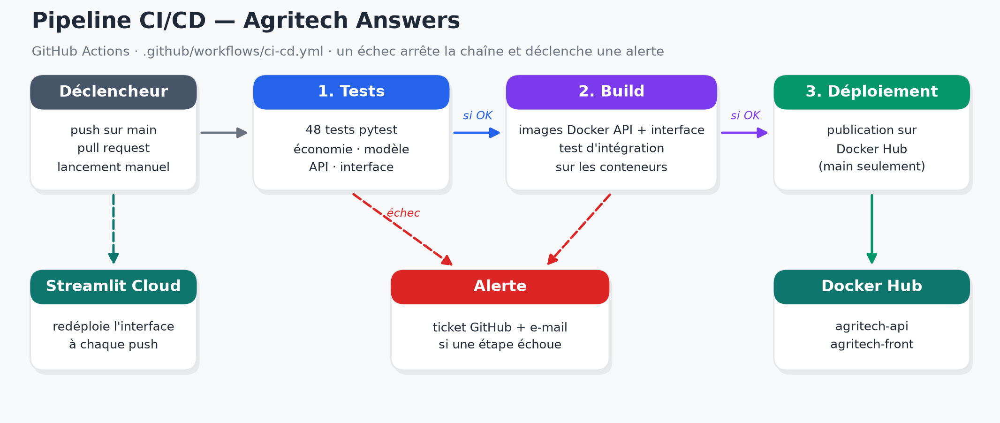

# Étape 5 — Résumé du pipeline CI/CD

*Document destiné à alimenter le rapport métier final. Workflow : `.github/workflows/ci-cd.yml`. Documentation détaillée : `docs/CI_CD.md`. Schéma : `reports/cicd/pipeline_cicd.png`.*

## 1. À quoi sert le pipeline

À chaque modification du code, une chaîne automatique vérifie l'application, la reconstruit et la met à disposition, **sans intervention manuelle**. Une erreur est donc détectée en quelques minutes, avant d'arriver chez les clients. Une version cassée n'est jamais publiée.

## 2. Les trois étapes

| Étape | Ce qu'elle fait | Ce qui l'arrête |
|---|---|---|
| **1. Tests** | Lance 48 tests automatisés sur le calcul économique, le modèle, l'API et l'interface | Un seul test en échec |
| **2. Build** | Construit les deux images Docker (API et interface), les lance ensemble et leur envoie de vraies requêtes | Image impossible à construire, service qui ne démarre pas, réponse incorrecte |
| **3. Déploiement** | Publie les images sur Docker Hub, avec une étiquette par version pour pouvoir revenir en arrière | Identifiants refusés |

- **Chaque étape ne démarre que si la précédente a réussi.**
- **En cas d'échec**, GitHub envoie un e-mail et le pipeline ouvre un ticket « Échec du pipeline CI/CD » avec le lien vers le détail.
- **L'interface** est redéployée automatiquement par Streamlit Community Cloud à chaque modification de la branche principale.

## 3. Quand le pipeline se lance

| Événement | Étapes |
|---|---|
| Modification de la branche principale (`main`) | Tests, Build, Déploiement |
| Proposition de modification (pull request) | Tests, Build : on vérifie sans rien publier |
| Lancement manuel | Toutes les étapes |

## 4. Ce que vérifient les tests

| Domaine | Tests | Exemples |
|---|---|---|
| Calcul économique | 22 | Marge = rendement × prix − coûts ; au seuil de rentabilité, la marge vaut exactement zéro, pour chaque culture |
| Modèle | 5 | Fichier lisible, prédictions positives et plausibles, l'engrais augmente le rendement |
| API | 14 | Prédiction, classement, refus des valeurs hors plage (par exemple 60 °C) |
| Interface | 7 | Chiffres affichés, graphique, tableau, message clair si l'API ne répond pas |
| **Intégration** | 4 contrôles | Sur les vrais conteneurs : service en ligne, classement des 4 cultures, refus d'une entrée invalide, interface accessible |

## 5. Sécurité et fiabilité

- **Aucun mot de passe ni clé dans le code.** Les accès à Docker Hub sont des « secrets » GitHub, masqués dans les journaux. On utilise un jeton révocable, pas le mot de passe.
- **Droits minimaux** : le pipeline ne peut que lire le code. Seule l'étape d'alerte peut ouvrir un ticket.
- **Mêmes versions partout** : les tests utilisent exactement les bibliothèques des images Docker.
- **Échecs vérifiés** : on a contrôlé en local que le test d'intégration échoue bien quand l'API est arrêtée.

## 6. Adaptation nécessaire : la taille du modèle

GitHub refuse les fichiers de plus de 100 Mo, et le modèle en faisait 104. Il est désormais enregistré **compressé : 37 Mo, avec exactement les mêmes prédictions**. Un test le vérifie à chaque exécution. L'image Docker de l'API est aussi passée de 816 à 747 Mo.

## 7. Ce qui reste à faire par l'équipe (une seule fois)

1. Envoyer le code sur le dépôt GitHub (https://github.com/JoseBravo26/P11_agritech).
2. Dans GitHub, renseigner l'identifiant Docker Hub (variable) et un jeton d'accès (secret) : le déploiement s'active alors tout seul.
3. Optionnel : héberger l'API (par exemple sur Render, offre gratuite suffisante : l'API utilise environ 330 Mo de mémoire) et brancher l'interface Streamlit Cloud sur son adresse.
4. Remplacer `UTILISATEUR_DOCKERHUB` dans le badge Docker Hub du `README.md`.

Ces étapes sont détaillées dans `docs/CI_CD.md`.
