# Agritech Answers — Recommander la culture la plus rentable

**Rapport métier · Projet de prédiction du rendement et de recommandation de cultures**

*Équipe Data, Agritech Answers · novembre 2026*

---

## Synthèse

**Le besoin.** Aider un agriculteur à répondre à deux questions :

- « Quel rendement puis-je attendre pour cette culture sur ma parcelle ? »
- « Quelle culture choisir pour gagner le plus ? »

**Ce qui a été livré.** Une application web en ligne, simple à utiliser :

| Livrable | Où le trouver |
|---|---|
| Application (interface) | https://p11-agritech-answers.streamlit.app |
| Service de prédiction (API) | https://agritech-api-usx2.onrender.com/docs |
| Code, tests et chaîne de production automatique | https://github.com/JoseBravo26/P11_agritech |

**Les résultats en cinq points.**

1. **Dans les données disponibles, six informations suffisent** pour prédire le rendement : la culture, la température, la pluie, le niveau d'intensification agricole du pays, l'usage d'engrais et l'irrigation. La région, le type de sol, la météo dominante et la durée de culture **n'y ont aucun lien mesurable avec le rendement**, car elles ont été générées au hasard dans le jeu simulé. L'analyse en composantes principales (ACP), les mesures de lien et le modèle concordent : sans ces quatre variables, le modèle est aussi précis. **Cela ne veut pas dire que le sol est sans effet en agriculture réelle** : c'est la première donnée à collecter auprès des clients.
2. **Le climat et le choix de la culture pèsent plus que les pratiques.** La chaleur fait baisser les rendements, et chaque culture a son climat idéal. L'engrais (+50 % de rendement environ) et l'irrigation (+40 %) comptent, mais moins.
3. **Le modèle est fiable.** Sur des situations qu'il n'a jamais vues, il se trompe en moyenne de **0,68 tonne par hectare**. Il explique **76 %** des écarts de rendement et classe correctement **84 %** des parcelles en « rentable » ou « non rentable ».
4. **La recommandation dépend du climat** :

    - maïs par temps frais ;
    - riz par temps chaud et humide ;
    - blé par temps chaud et plutôt sec ;
    - soja dans certaines niches.

    L'engrais est rentable pour toutes les cultures ; l'irrigation, seulement pour le riz.

5. **L'outil est industrialisé.** Chaque modification du code est testée automatiquement (49 tests), puis reconstruite et remise en ligne sans intervention.

**Point d'attention.** Les prix et les coûts sont des **références publiques** (Banque mondiale, ministère américain de l'Agriculture). Ils doivent être remplacés par les chiffres réels de chaque exploitation. Ce changement ne demande pas de réentraîner le modèle.

---

## 1. Le besoin

Agritech Answers veut proposer à ses clients agriculteurs un outil d'aide à la décision, avec deux fonctions dans une même interface :

| Fonction | L'agriculteur indique | L'outil répond |
|---|---|---|
| **Prédiction** | Une culture et les conditions de sa parcelle | Le rendement attendu (t/ha), la marge estimée et le rendement minimal pour être rentable |
| **Recommandation** | Les conditions de sa parcelle uniquement | Les quatre cultures simulées et classées, avec la plus rentable mise en avant |

---

## 2. Les données

### 2.1 Deux sources complémentaires

| | Agriculture Crop Yield | Crop Yield Prediction (FAO) |
|---|---|---|
| **Contenu** | 1 000 000 de parcelles : sol, région, culture, pluie, température, engrais, irrigation, météo, durée de culture, rendement | Rendements réels par pays, culture et année (1990-2013), avec pluie, température et pesticides |
| **Nature** | Données simulées : chaque situation y est représentée de façon équilibrée | Données réelles (FAO, Banque mondiale) |
| **Apport** | L'effet des **pratiques** (engrais, irrigation) | Les écarts **entre cultures** et l'effet réel du **climat** |
| **Limite** | Le rendement y est **le même pour toutes les cultures** : seul, ce jeu ne permet pas de recommander une culture | Ni engrais ni irrigation ; pesticides comptés au niveau du pays entier |

### 2.2 Le nettoyage

| Problème | Décision |
|---|---|
| 231 rendements négatifs | Supprimés (impossibles) |
| Orge et coton absents des données réelles | Périmètre limité aux **4 cultures communes : maïs, riz, soja, blé** |
| Données FAO répétées (une ligne par station météo) | Une seule ligne par pays, culture et année : 28 242 lignes ramenées à 13 130 observations réelles |
| Rendements extrêmes (micro-surfaces) | Plafonnés au 99ᵉ percentile de chaque culture |

### 2.3 La fusion

Les deux sources n'ont **aucune clé commune** (ni pays ni année dans le jeu de parcelles). Chaque parcelle a donc été associée à une **observation réelle de la même culture, au climat le plus proche**. Elle en reçoit le niveau d'intensification (pesticides) et le rendement réel. Ce rendement est ensuite ajusté selon les pratiques de la parcelle : ×0,68 sans engrais ni irrigation, jusqu'à ×1,32 avec les deux.

**Résultat :** un jeu consolidé de **666 494 parcelles** (4 cultures, sans valeur manquante ni doublon). Il réunit l'effet réel du climat et de la culture et l'effet des pratiques culturales.

---

## 3. Les variables clés : l'analyse en composantes principales (ACP)

**L'ACP en deux phrases.** Elle résume un grand nombre de variables en quelques « axes ». Les variables portées par le même axe varient ensemble : si le rendement et la pluie sont sur le même axe, ils montent et descendent ensemble.

**Ce que l'ACP peut et ne peut pas dire.**

| L'ACP permet de… | L'ACP ne permet pas de… |
|---|---|
| Voir quelles variables varient ensemble, et lesquelles varient avec le rendement (placé parmi les variables analysées) | Mesurer à elle seule le pouvoir prédictif d'une variable : c'est une méthode descriptive |
| Repérer les variables redondantes : elles se regroupent sur un même axe | Prouver qu'une variable est sans effet dans la réalité : elle ne voit que ce que contiennent les données |
| Voir si les modalités d'une variable qualitative (sol, région…) se distinguent sur l'axe du rendement | Remplacer un test sur un modèle |

C'est pourquoi chaque conclusion de l'ACP a été **vérifiée par deux mesures supervisées** : le lien direct de chaque variable avec le rendement (section 3.3), et la précision du modèle avec ou sans ces variables (section 4).

### 3.1 Sur le million de parcelles : un seul axe, celui du rendement

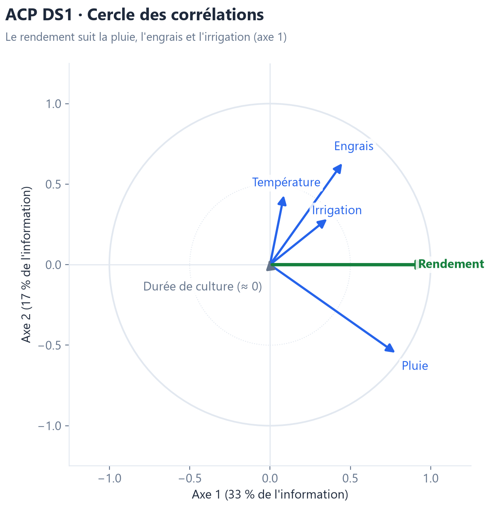

| Variable | Lien avec l'axe du rendement | Verdict |
|---|---|---|
| Pluie | 0,79 | **Clé** |
| Engrais | 0,46 | **Clé** |
| Irrigation | 0,37 | **Clé** |
| Température | 0,09 | Faible ici, mais clé dans les données réelles (voir 3.2) |
| Durée de culture | 0,01 | Aucun lien mesurable dans ce jeu |

- **Le premier axe porte à lui seul le rendement** (corrélation de 0,99). Il réunit la pluie, l'engrais et l'irrigation.
- **Les autres axes ne regroupent rien.** Chacun résume autant d'information qu'une variable isolée : les variables de ce jeu sont **indépendantes entre elles, et non redondantes**. Aucune ne double une autre : si la région ou la météo reprenaient l'information de la température ou de la pluie, elles se regrouperaient avec elles sur un même axe.

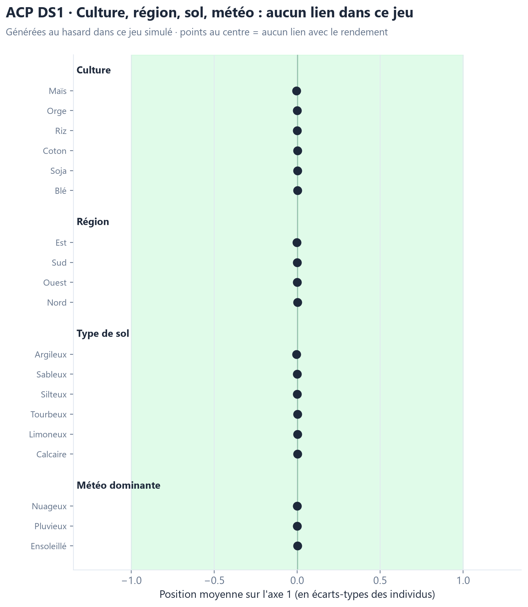

**Région, type de sol, météo dominante, et même culture : aucun lien avec le rendement dans ce jeu.** Toutes leurs modalités se placent au centre de l'axe du rendement : chacune de ces variables en explique moins de 0,001 %. Elles ont été générées au hasard, indépendamment du rendement.

**C'est une propriété du jeu simulé, pas de l'agriculture réelle.** Personne ne soutient qu'un sol sableux et un sol argilo-limoneux donnent les mêmes rendements : réserve en eau, pH et nutriments jouent un rôle connu. Ces données ne permettent simplement pas de mesurer cet effet. De même, l'absence d'effet de la culture dans ce jeu montre qu'il ne suffit pas pour choisir une culture : d'où la fusion avec les données réelles de la FAO.

### 3.2 Validation sur les données réelles (FAO)

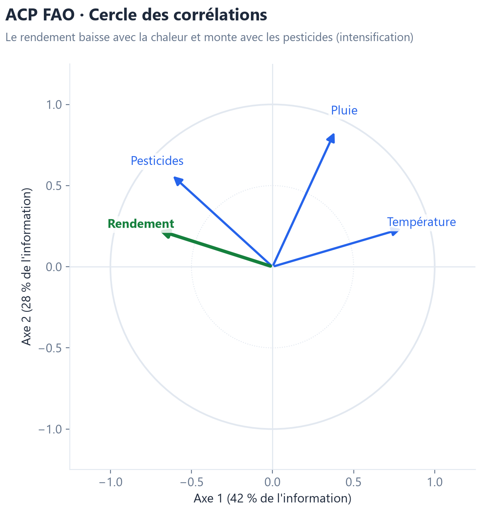

| Ce que montrent les données réelles | Conséquence |
|---|---|
| **La chaleur fait baisser les rendements** : le rendement s'oppose à la température sur le premier axe | La température est une variable clé, plus que ne le laissait penser le jeu simulé |
| **L'intensification les fait monter** : les pesticides vont avec le rendement | Les pesticides servent d'indicateur du niveau d'intensification du pays |
| **La pluie annuelle est presque sans lien avec le rendement** (corrélation −0,08) | Les pays secs irriguent : la pluie compte, mais moins que dans le jeu simulé |
| **Les cultures ont des rendements très différents** | La culture est une variable clé (médianes : riz 3,4 · maïs 2,5 · blé 2,4 · soja 1,6 t/ha) |

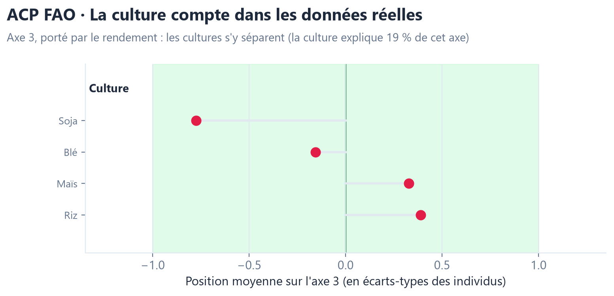

### 3.3 Verdict : six variables clés

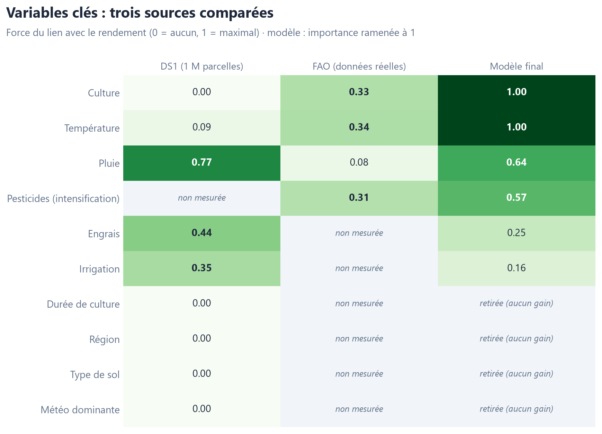

| Variable | Verdict | En pratique, pour l'agriculteur |
|---|---|---|
| **Culture** | Clé | Le choix de la culture est le premier levier de rendement |
| **Température** | Clé | Chaque culture a son climat idéal |
| **Pluie** | Clé | Favorable jusqu'à un certain point ; l'irrigation peut compenser |
| **Intensification (pesticides)** | Clé | Indique le niveau technique de l'agriculture du pays |
| **Engrais** | Clé | Environ +50 % de rendement |
| **Irrigation** | Clé | Environ +40 % de rendement |
| Région, sol, météo dominante, durée de culture | **Non retenues pour l'instant** | Sans lien mesurable dans les données disponibles. À réintroduire dès que des données réelles existent (en priorité le sol) |

**Ces six variables sont exactement celles du modèle final et de l'application.** Le modèle sans les quatre variables non retenues est aussi précis que le modèle complet : même erreur type en validation croisée, 1,24 t/ha. Ce verdict vaut pour ces données : avec des mesures de sol réelles, l'analyse serait à refaire.

---

## 4. Le modèle de prédiction

### 4.1 Comment il a été choisi

Cinq approches ont été comparées sur les mêmes données. Leurs performances sont mesurées par validation croisée, c'est-à-dire en moyenne sur plusieurs découpages des données d'entraînement.

| Modèle | Erreur type (t/ha) | Part des écarts expliquée (R²) | Rentabilité bien classée |
|---|---|---|---|
| Moyenne (référence) | 2,43 | 0 % | 69 % |
| Régression linéaire | 1,94 | 36 % | 70 % |
| Gradient boosting | 1,25 | 74 % | 81 % |
| **Forêt aléatoire (retenue)** | **1,24** | **74 %** | **84 %** |

- **La régression linéaire échoue** : l'effet du climat dépend de la culture (le maïs aime la fraîcheur, le riz la chaleur), ce qu'un modèle linéaire ne sait pas représenter.
- **La forêt aléatoire est retenue** pour sa meilleure précision sur la rentabilité. Vingt réglages ont ensuite été testés, avec un gain d'environ 1 %.

### 4.2 Sa performance réelle

Le modèle a été évalué **une seule fois**, sur 20 % des données mises de côté dès le départ. Ces données proviennent de **pays et d'années que le modèle n'a jamais vus**, comme un nouveau client.

| Indicateur | Résultat | Ce que cela veut dire |
|---|---|---|
| Erreur moyenne | **0,68 t/ha** | Pour un rendement de 3 t/ha, la prédiction est en moyenne entre 2,3 et 3,7 t/ha |
| Part des écarts expliquée (R²) | **76 %** | Le modèle explique les trois quarts des différences de rendement |
| Rentabilité bien classée | **84 %** | 5 parcelles sur 6 sont correctement jugées rentables ou non |
| Culture la mieux prédite | Riz (erreur relative 19 %) | |
| Culture la moins bien prédite | Maïs (28 %) | C'est la culture dont les rendements varient le plus |

Un découpage au hasard aurait affiché R² = 0,91. Il aurait laissé le modèle « reconnaître » des pays déjà vus, ce qui donne une performance trop optimiste. Le chiffre retenu, 0,76, est le plus honnête.

### 4.3 Traçabilité (MLflow)

Toutes les expériences sont enregistrées dans MLflow, avec leurs paramètres, leurs résultats et leurs graphiques. Le modèle mis en service est versionné dans un registre. Les captures d'écran sont en annexe A.

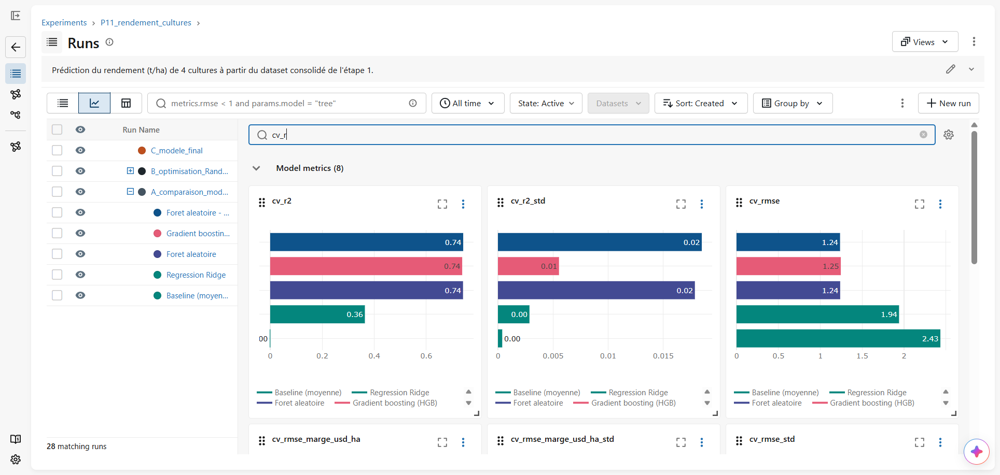

---

## 5. Résultats et recommandations agronomiques

### 5.1 Quelle culture selon le climat

| Climat de la parcelle | Culture recommandée | Commentaire |
|---|---|---|
| Frais (moins de 21 °C) | **Maïs** | Quelle que soit la pluie |
| Chaud (22-30 °C) et humide (600-900 mm) | **Riz** | Sa zone s'élargit avec l'irrigation |
| Chaud (plus de 27 °C) et plutôt sec (moins de 700 mm) | **Blé** | Culture la plus souvent recommandée (32 à 38 % des climats) |
| Très arrosé (900 mm et plus) au-delà de 27 °C, ou tiède et sec | **Soja** | Peu de tonnes, mais un bon prix de vente |

### 5.2 Les pratiques culturales

| Pratique | Effet sur le rendement | Rentable ? |
|---|---|---|
| **Engrais** | Environ +50 % | **Oui, pour toutes les cultures** : +94 à +160 USD/ha en moyenne. Rentable sur 97 % des parcelles de soja, mais seulement 60 % des parcelles de maïs |
| **Irrigation** | Environ +40 % | **Seulement pour le riz** (+71 USD/ha en moyenne). Pour les autres cultures, son coût dépasse le gain (−18 à −34 USD/ha) |

### 5.3 Exemple concret

Parcelle à **25 °C, 600 mm de pluie**, intensification moyenne, **avec engrais**, sans irrigation :

| Culture | Rendement prédit | Marge estimée | Rendement minimal pour être rentable |
|---|---|---|---|
| **Riz** | **5,3 t/ha** | **655 USD/ha** | 2,9 t/ha |
| Soja | 1,6 t/ha | 426 USD/ha | 0,6 t/ha |
| Blé | 2,4 t/ha | 263 USD/ha | 1,3 t/ha |
| Maïs | 2,3 t/ha | 130 USD/ha | 1,6 t/ha |

**Le soja est dernier en tonnes mais deuxième en marge** : il se vend environ deux fois plus cher que les céréales. C'est pourquoi l'application affiche à la fois le classement par rendement et la culture la plus rentable.

### 5.4 Hypothèses économiques

| Culture | Prix de vente (USD/t) | Coût de base (USD/ha) | Coût de l'engrais (USD/ha) |
|---|---|---|---|
| Maïs | 203 | 206 | 125 |
| Riz | 273 | 595 | 195 |
| Soja | 414 | 196 | 61 |
| Blé | 243 | 188 | 122 |

- **Sources :**
    - prix : Banque mondiale, moyenne 2025 ;
    - coûts : ministère américain de l'Agriculture (USDA, 2025), ramenés au niveau de rendement des parcelles étudiées ;
    - irrigation : 200 USD/ha, ordre de grandeur non sourcé.
- **La marge est calculée sur les coûts de production** (semences, traitements, carburant…), hors terre et matériel.
- **Ces chiffres sont à remplacer par ceux de chaque client.** Le modèle prédit des tonnes : changer les prix ou les coûts modifie la marge et le classement, sans réentraînement.

---

## 6. L'application

*Exemple ci-dessous : une parcelle en France, à 25 °C et 600 mm de pluie, avec engrais. L'agriculture française étant très intensive, les rendements prédits sont plus élevés que dans l'exemple de la section 5.3, qui suppose une intensification moyenne.*

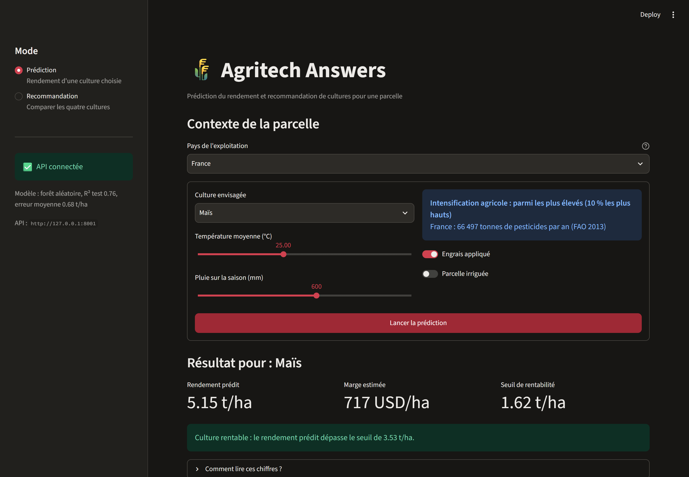

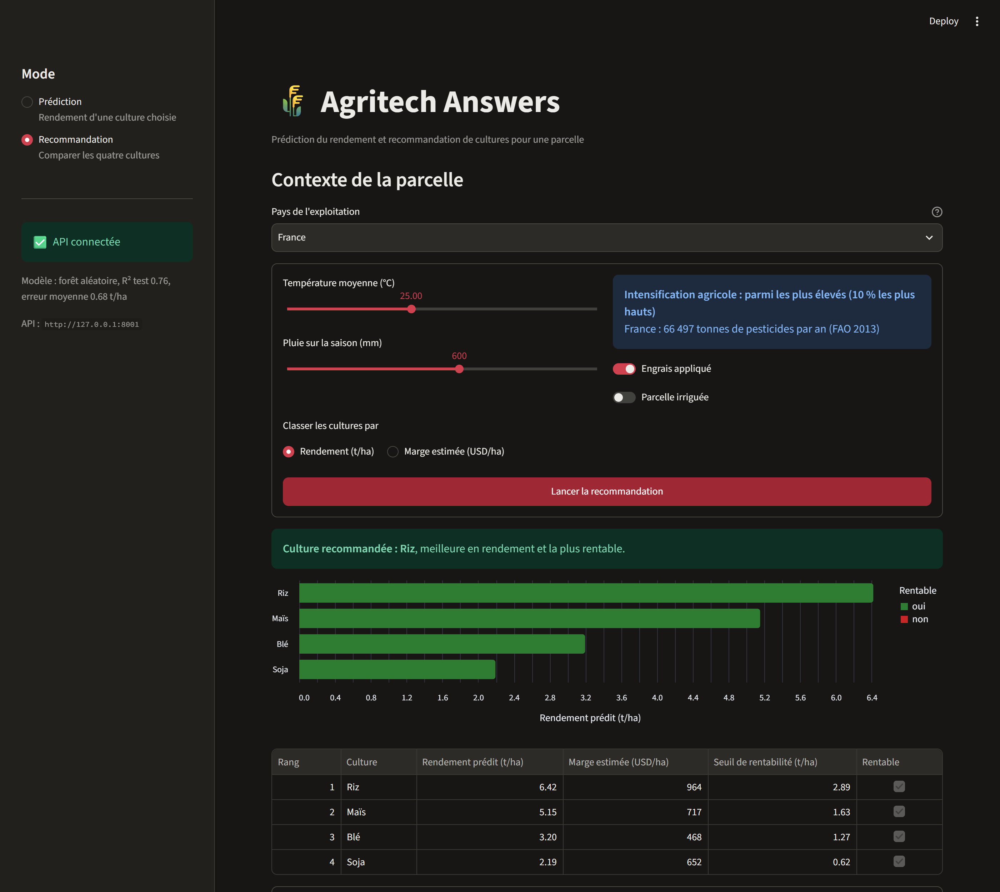

| Étape | Ce que fait l'utilisateur |
|---|---|
| 1 | Choisit le mode : **Prédiction** (une culture) ou **Recommandation** (les quatre) |
| 2 | Choisit **le pays de son exploitation** (101 pays) : l'outil en déduit le niveau d'intensification agricole. Si son pays n'est pas dans la liste, il choisit un niveau (faible, médian, élevé, très élevé) |
| 3 | Décrit sa parcelle avec des curseurs (température, pluie) et deux interrupteurs (engrais, irrigation) |
| 4 | Clique sur le bouton pour lancer le calcul |
| 5 | Lit le résultat : trois chiffres en prédiction ; un graphique (vert si rentable, rouge sinon) et un tableau classé en recommandation |

**Garde-fous :**

- les curseurs sont limités aux conditions connues du modèle : au-delà, il ne serait pas fiable ;
- une valeur hors plage est refusée avec un message clair ;
- l'onglet « Comment lire ces chiffres ? » rappelle que les prix sont des hypothèses.

**Architecture.** L'interface ne contient aucun calcul : elle interroge un service séparé, l'API, qui contient le modèle. Le modèle peut ainsi être mis à jour sans toucher à l'interface, et d'autres outils peuvent utiliser la même API.

---

## 7. Fiabilité et mise en production

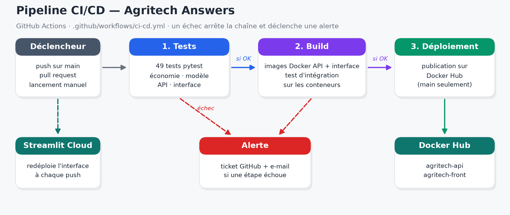

| Garantie | Comment |
|---|---|
| **Qualité** | 49 tests automatiques : calcul de la marge, modèle, API et interface. S'y ajoute un test de bout en bout sur les vrais conteneurs |
| **Aucune version cassée en ligne** | Chaque étape (tests, puis construction, puis mise en ligne) ne démarre que si la précédente a réussi |
| **Mise à jour automatique** | Chaque modification validée est publiée (images Docker sur Docker Hub), puis l'API (Render) et l'interface (Streamlit Cloud) sont redéployées |
| **Alerte** | En cas d'échec, un e-mail est envoyé et un ticket est ouvert automatiquement |
| **Retour en arrière possible** | Chaque version est conservée et peut être remise en service |
| **Sécurité** | Aucun mot de passe dans le code : les accès sont des secrets chiffrés |
| **Reproductibilité** | Graine aléatoire fixe, versions des bibliothèques figées, toutes les expériences tracées dans MLflow |

---

## 8. Limites et prochaines étapes

| Limite | Conséquence | Piste |
|---|---|---|
| Le jeu de parcelles est simulé, et son rendement cible a été construit par fusion | Une part de hasard limite la précision atteignable | Collecter des rendements réels chez les clients |
| Le type de sol, la région et la météo n'ont pas d'effet mesurable, car ils ont été générés au hasard dans le jeu simulé | L'outil ne tient pas compte du sol, alors qu'il compte en agriculture réelle (réserve en eau, pH, nutriments) | Collecter en priorité des données de sol réelles (texture, pH, réserve utile), puis réentraîner le modèle : le pipeline est prêt |
| L'effet de l'engrais et de l'irrigation est le même pour toutes les cultures | Les gains réels peuvent varier selon la culture | Le mesurer sur des essais de terrain |
| Les pesticides sont un total national | Ils mesurent un niveau d'intensification du pays, pas une dose à appliquer. L'agriculteur n'a pas à connaître ce chiffre : il choisit son pays, et la valeur FAO est retrouvée automatiquement (données de 2013) | Remplacer cet indicateur par une donnée de l'exploitation (doses de traitement par hectare) et actualiser les valeurs par pays |
| Prix et coûts de référence | Les marges sont indicatives | Laisser l'agriculteur saisir ses propres prix et coûts dans l'interface |
| Quatre cultures seulement | Orge, coton et autres cultures non couvertes | Ajouter des cultures dès que des données réelles existent |
| Hébergement gratuit | L'API se met en veille : le premier calcul après une pause peut prendre une minute | Passer à une offre payante pour un usage client |

---

## Annexe A — Captures MLflow

| Capture | Ce qu'elle montre |
|---|---|
| 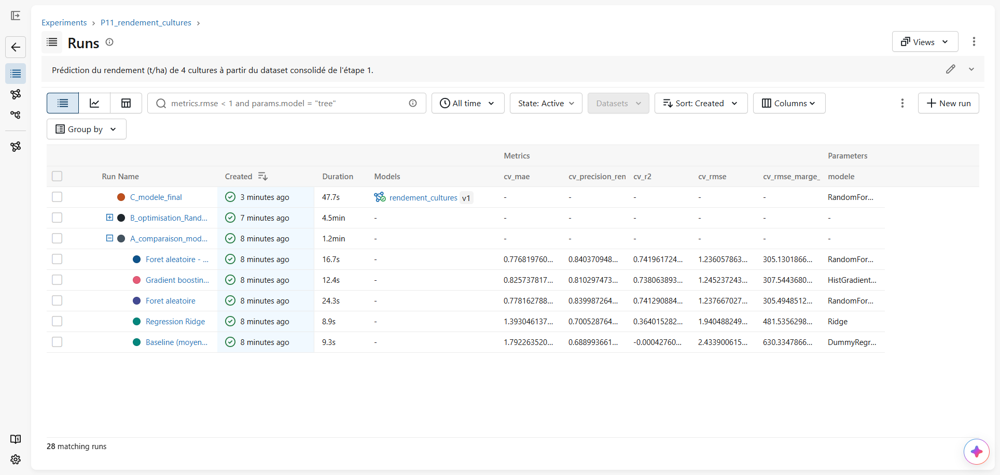 | Les trois étapes d'expérimentation (comparaison, optimisation, modèle final) et les cinq modèles comparés |
| 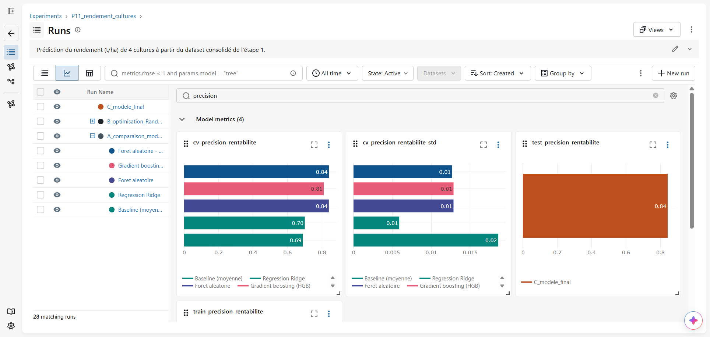 | Rentabilité bien classée par chaque modèle |
| 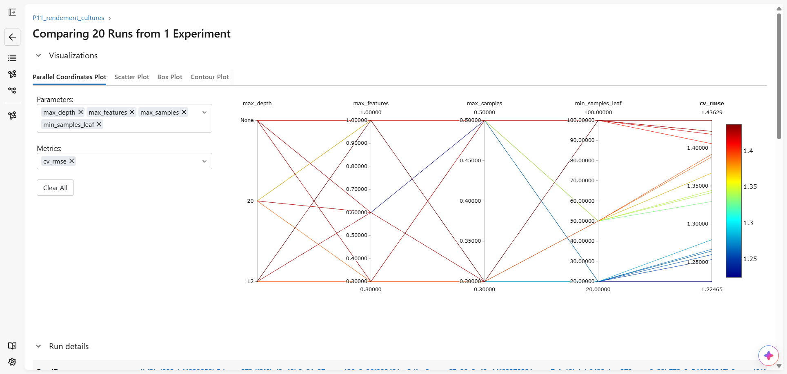 | Les 20 réglages testés : la taille minimale des feuilles des arbres est le réglage décisif |
| 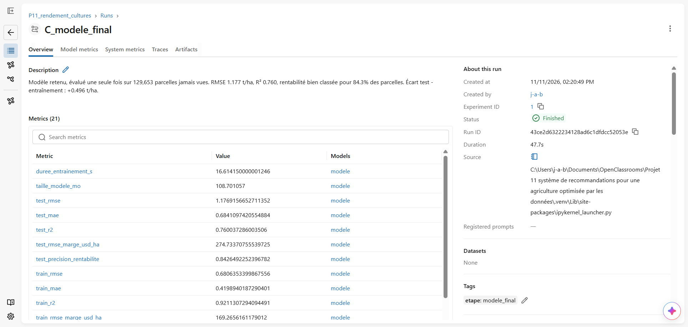 | Résultats du modèle final sur le jeu de test |
| 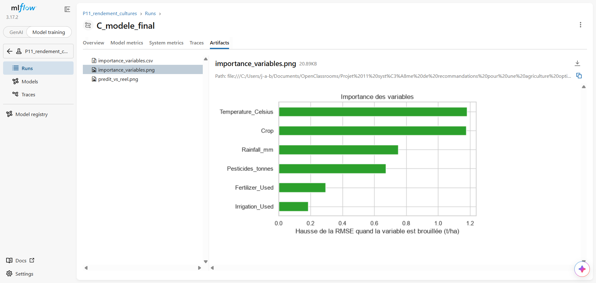 | Graphiques enregistrés avec le modèle final (importance des variables) |
| 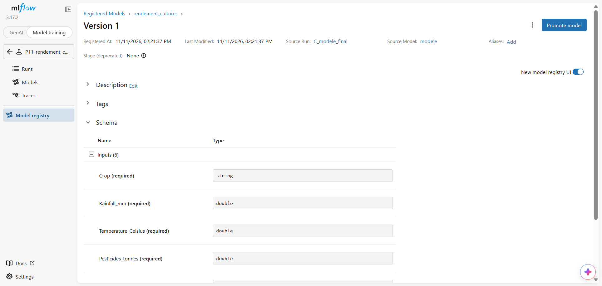 | Registre des modèles : `rendement_cultures`, version 1, avec ses 6 variables d'entrée |

## Annexe B — Glossaire

| Terme | Définition |
|---|---|
| **Rendement** | Récolte en tonnes par hectare (t/ha) |
| **Marge** | Rendement × prix de vente − coûts de production, en dollars par hectare |
| **Seuil de rentabilité** | Rendement minimal pour que la marge soit positive |
| **ACP** | Analyse en composantes principales : méthode qui résume de nombreuses variables en quelques axes, pour repérer celles qui vont ensemble |
| **R²** | Part des différences de rendement expliquée par le modèle (100 % = parfait) |
| **Forêt aléatoire** | Modèle qui combine des centaines d'arbres de décision et fait la moyenne de leurs prédictions |
| **API** | Service en ligne qui reçoit les conditions d'une parcelle et renvoie les prédictions |
| **CI/CD** | Chaîne automatique qui teste, construit et met en ligne chaque nouvelle version |
| **MLflow** | Outil qui enregistre chaque expérience (paramètres, résultats, modèles) pour les comparer et les retrouver |

## Annexe C — Livrables

| Livrable | Fichier |
|---|---|
| Préparation et fusion des données | `src/preparation_donnees.py`, `notebooks/01_exploration_fusion.ipynb` |
| ACP | `src/acp.py`, `notebooks/03_acp.ipynb` |
| Entraînement et suivi MLflow | `src/entrainement.py`, `notebooks/02_modelisation.ipynb` |
| Hypothèses économiques | `src/economie.py` |
| API | `api/main.py`, `Dockerfile` |
| Interface | `frontend/app.py` |
| Pipeline CI/CD | `.github/workflows/ci-cd.yml`, `docs/CI_CD.md` |
| Tests | `tests/` (49 tests) |
